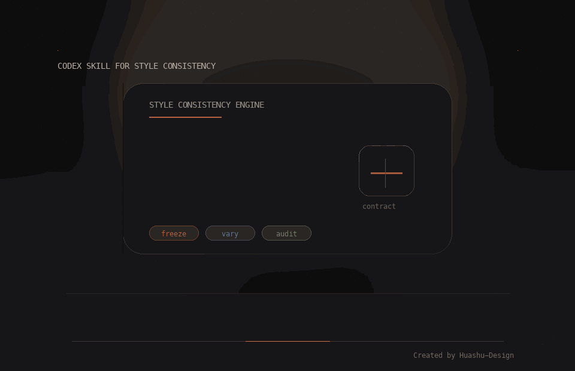

# Style Anchor

<p align="center"><a href="./README.md">English</a> | <a href="./README_zh.md">中文</a></p>

A Codex skill for keeping batch-generated images and text in one coherent style.



<p align="center"><sub>Animated preview generated with the <a href="https://github.com/alchaincyf/huashu-design">huashu-design</a> skill.</sub></p>

It is designed for workflows where consistency matters more than one-off novelty, such as:

- texture and material sets
- icon, sprite, or illustration families
- poem, lyric, slogan, or naming series
- reusable prompt packages for style-locked generation

## What It Does

Style Anchor helps Codex keep a large batch aligned by using a simple operating model:

1. Lock a `style contract`
2. Separate fixed traits from allowed variation
3. Generate in small batches
4. Audit style drift after each batch
5. Repair only the off-style items

This makes it more reliable than repeatedly adding new style adjectives to prompts.

## Included Files

- [SKILL.md](./SKILL.md): main skill definition
- [references/style-contract.md](./references/style-contract.md): style contract template
- [references/media-recipes.md](./references/media-recipes.md): image and text generation recipes
- [references/texture-imagegen.md](./references/texture-imagegen.md): texture-focused subtemplate for `imagegen`
- [agents/openai.yaml](./agents/openai.yaml): Codex UI metadata

## Best For

- generating a family of textures that should feel like one set
- writing multiple poems in the same voice
- creating asset batches with controlled variation
- turning a few references into a repeatable style workflow

## Texture Workflow

The skill includes a texture-oriented subtemplate for `imagegen`.

It is especially useful when you need:

- seamless or near-seamless texture batches
- consistent lighting, distance, and material finish
- controlled variation in wear, grain, cracks, stains, or embossing
- a stable master prompt plus per-item slots

## Example Prompts

```text
Use $style-anchor to create 12 hand-painted stone wall textures with one consistent style.
```

```text
Use $style-anchor to write 8 short winter poems in one restrained, melancholic voice.
```

```text
Use $style-anchor to build a reusable prompt package for a cohesive icon family.
```

## Repository Notes

- `SKILL.md` is the canonical runtime file.
- `SKILL_zh.md` is intentionally ignored locally and is not part of the Git-tracked package.
- `README_zh.md` provides the public Chinese repository overview.

## License

This project is licensed under the [MIT License](./LICENSE), which allows free use, modification, distribution, and commercial use.
